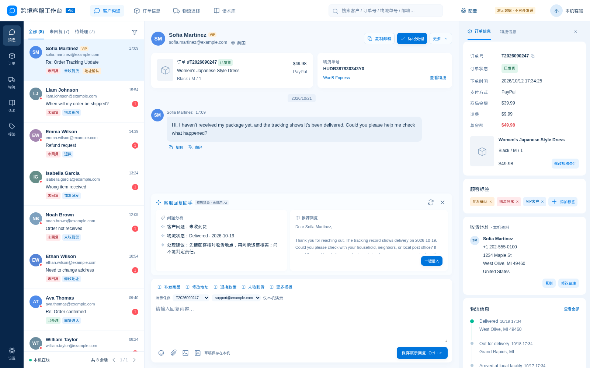
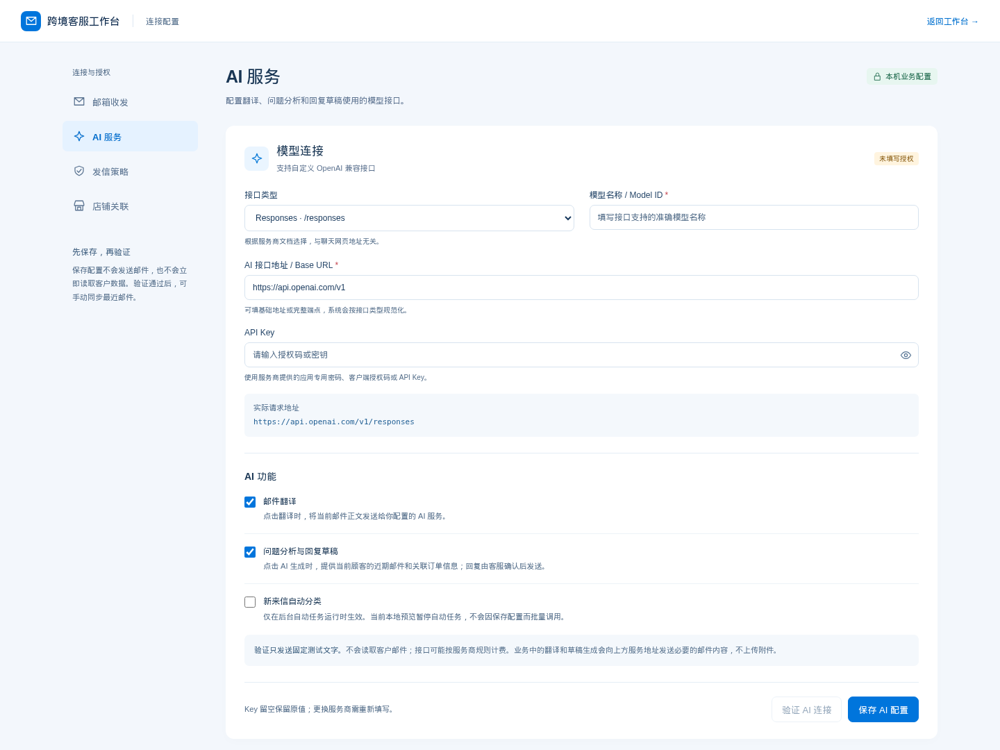

# Maildesk · 跨境客服工作台

基于现有 Maildesk 源码完善的本地客服系统：客户邮件、关联订单、物流展示、话术与 AI 辅助集中在一个蓝白工作台。

这是清理后的公开源码副本。包含模拟数据生成脚本，**不包含真实客户/订单数据库、邮箱授权、AI Key、局域网访问码、附件、原交接包或本机运行时**。原店铺和邮箱标识已替换为示例值。

[MIT 许可证](LICENSE) · [第三方声明](THIRD_PARTY_NOTICES.md) · [参与贡献](CONTRIBUTING.md) · [版本记录](CHANGELOG.md)

## 真实运行截图

以下图片由本仓库源码在 Node.js 24.22.0 下实际运行后，通过 Chromium 截取。界面中的顾客、订单和物流均为仓库自带的虚构演示数据，不是生产数据，也不是设计效果图。



<details>
<summary>查看移动端和 AI 配置页面</summary>




</details>

[截图环境、源码版本与复现方式](docs/screenshots/README.md)。

## 启动

安装 Node.js 24 或更新版本。本次在 Node.js 24.22.0 下通过 49 项测试；使用锁定依赖复现环境：

```sh
git clone https://github.com/shenxianlaodie/maildesk.git
cd maildesk
npm install --global pnpm@10.34.7
pnpm install --frozen-lockfile --ignore-scripts
pnpm start
```

打开 http://127.0.0.1:4174/ 。首次启动自动创建8位模拟顾客，演示回复只保存在本机，不对外发送。

另开终端启动业务服务：

```sh
npm run start:business
```

打开 http://127.0.0.1:4175/config 配置邮箱和 AI；http://127.0.0.1:4175/ 为业务工作台。公开仓库未携带业务数据，首次启动为新建环境。Windows 也可在安装依赖后运行 04-preview.cmd 启动演示。

局域网入口与独立管理码说明见 [配置文档](docs/CONFIGURATION.md)。

## 已实现

- 会话分页、搜索、未回复/待处理筛选，标签、客服分配和顾客资料。
- 邮件详情、附件、草稿自动保存、回复与话术模板。
- 关联订单、物流轨迹展示，地址和规格的本机备注。
- 自定义 IMAP/SMTP、自定义 AI 接口与模型、连接验证及发信测试范围。
- 邮件翻译、问题分析和回复草稿；未配置 AI 时使用明确标注的规则建议。
- 独立局域网测试登录、独立管理配置登录及权限隔离。

售后工单、ERP、商品管理、数据报表暂未开发。没有接入实时物流服务；缺少轨迹时会明确显示，演示轨迹是模拟数据。地址/规格修改只记本机备注，不更新店铺或仓库。

## 测试

```sh
npm test
node scripts/audit-licenses.cjs --check
```

测试使用内存或临时数据库及模拟连接，不调用真实邮箱/AI。真实服务的可用性与邮件投递仍需填写自己的授权后验证。

## 目录

- backend/：Node.js HTTP、SQLite、邮箱、AI 与局域网代理。
- backend/public/desk/：主工作台；backend/public/settings/：配置页。
- scripts/：启动、模拟数据生成与原交接打包逻辑。
- tests/：功能、配置和权限隔离测试。
- docs/：通用运行配置和 REA 分析说明。

自动任务在预览启动脚本中暂停。停止终端进程即可停止服务；本仓库不会自动配置开机启动或修改防火墙。

## 许可与再分发

项目代码采用 [MIT License](LICENSE)。已核查锁定的 46 个 npm 依赖并保留其许可原文；内嵌 Feather 图标保留上游版权声明。具体分发条件、版本范围及不包含的运行时/业务资料见 [THIRD_PARTY_NOTICES.md](THIRD_PARTY_NOTICES.md)。
